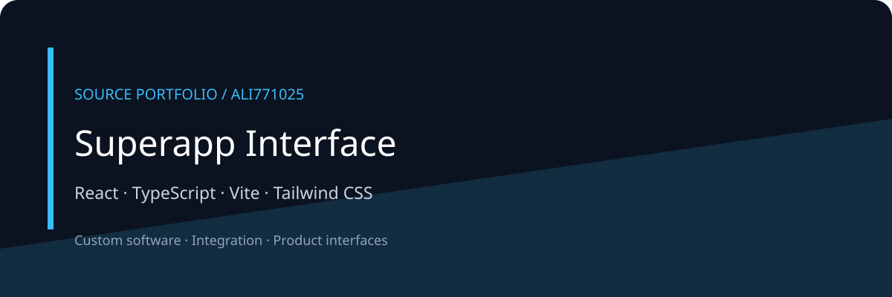

# Superapp Interface



A React and TypeScript superapp interface exploration with a shared shell, modular experiences and design-system source. Wallet and on-chain integrations are represented by preview adapters; this edition makes no claim of audited contracts or live financial operation.

[معرفی فارسی](docs/README.fa.md) · [Architecture](docs/ARCHITECTURE.md) · [Discuss a project](https://github.com/Ali771025)

## What this portfolio shows

- Shared shell and feature modules provide a navigable product interface.
- Design-system source centralizes reusable visual patterns.
- Integration adapters remain examples requiring independent service configuration.

## Technology

React · TypeScript · Vite · Tailwind CSS

## Local orientation

These are source-derived starting commands, not a verified deployment recipe. Review configuration and dependencies first.

```bash
npm ci
npm run dev
```

All credentials, infrastructure and datasets must be supplied independently. See configuration modules for required variables. Binary assets and customer documents are deliberately absent; some visual asset references may need replacements.

## Edition and verification

This is a compact public source edition. Original history, contracts, private documents, databases, logs, generated output and dependency directories are excluded. No build, test, deployment, security certification or production-readiness claim is made for this edition. Public documentation and diagrams describe source structure; they are not application screenshots.

## Work together

For a related product, integration or custom workflow, [contact Ali through GitHub](https://github.com/Ali771025). Share your intended users, workflow and integration needs to scope the work.

No new license grant is added by this portfolio edition. Third-party components remain subject to their own terms.
