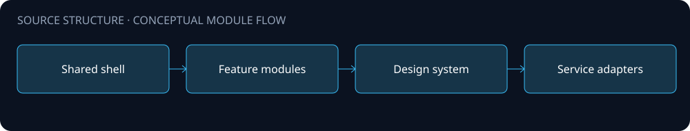
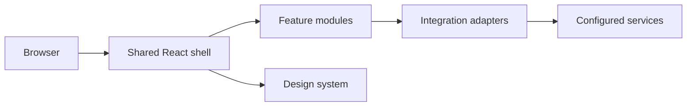

# Architecture

A React and TypeScript interface exploration with a shared shell, modular experiences and design-system source.

The diagram is a source-level orientation. Arrows describe intended module relationships; integration availability and end-to-end behavior were not validated for this public edition.

## Boundaries

- Shared shell and feature modules provide a navigable product interface.
- Design-system source centralizes reusable visual patterns.
- Integration adapters remain examples requiring independent service configuration.

## Configuration and data

Configure your own environment and service endpoints. Never place API keys, production connection strings, customer records or uploaded documents in this repository. Public source omits operational assets and does not include a production deployment guarantee.

## Preview and chain boundary

`src/lib/contracts/contractConfig.ts` defaults to preview mode and empty contract addresses. Blockchain adapters still use fixture responses. UI balances, transactions and product figures are demonstrations, not evidence of real transactions or economic outcomes. Independently configure and review every adapter before connecting services.
